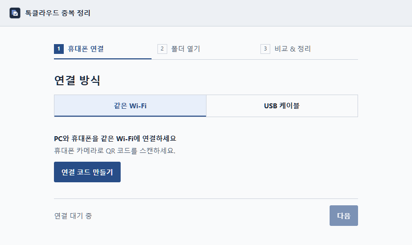
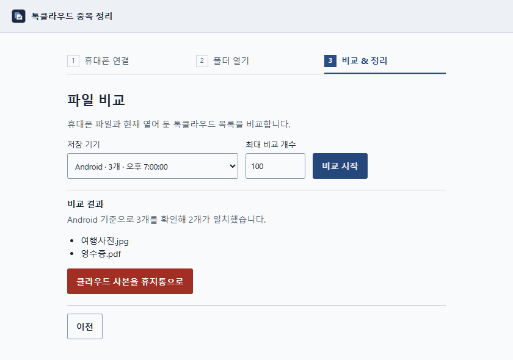

# 톡클라우드 중복 정리

휴대폰에 이미 저장한 파일과 내용이 같은 톡클라우드 사본을 찾습니다. 일치 목록을 확인한 뒤 클라우드 사본을 휴지통으로 옮길 수 있습니다.

## 설치

| 내 컴퓨터 | 다운로드 | 설치 방법 |
| --- | --- | --- |
| Windows x64 | [Windows 설치 파일 (.exe)](https://github.com/thisis-joe/talkcloud-cleaner/releases/download/v0.2.1/TalkCloudCleaner-0.2.1-windows-x64.exe) | 받은 파일을 두 번 클릭합니다. |
| Mac Apple Silicon | [Apple Silicon용 (.dmg)](https://github.com/thisis-joe/talkcloud-cleaner/releases/download/v0.2.1/TalkCloudCleaner-0.2.1-mac-arm64.dmg) | DMG를 열어 앱을 응용 프로그램 폴더로 옮깁니다. |
| Mac Intel | [Intel용 (.dmg)](https://github.com/thisis-joe/talkcloud-cleaner/releases/download/v0.2.1/TalkCloudCleaner-0.2.1-mac-x64.dmg) | DMG를 열어 앱을 응용 프로그램 폴더로 옮깁니다. |

Mac 종류는 ** → 이 Mac에 관하여**에서 확인합니다. **칩**에 Apple이 표시되면 Apple Silicon용, **프로세서**에 Intel이 표시되면 Intel용을 받으세요. 앱은 터미널 없이 실행할 수 있습니다.

> **첫 실행 때 보안 경고가 뜰 수 있습니다.** v0.2.1의 Windows 설치 파일은 서명되지 않았고 macOS 앱은 Apple 공증을 받지 않았습니다. 경고가 뜨면 파일을 이 저장소의 Releases에서 받았는지 확인하세요.

[릴리스 및 보안 안내](https://github.com/thisis-joe/talkcloud-cleaner/releases/latest) · [v0.2.1 체크섬](https://github.com/thisis-joe/talkcloud-cleaner/releases/download/v0.2.1/SHA256SUMS.txt)

## 사용 방법

1. **휴대폰 연결.** 휴대폰과 컴퓨터를 같은 Wi-Fi에 연결합니다. 앱에서 **연결 코드 만들기**를 누른 뒤 휴대폰으로 QR을 스캔합니다. 파일을 고르고 **지문 보내기**를 누릅니다.
2. **폴더 열기.** PC 앱에서 **톡클라우드 열기**를 눌러 로그인한 뒤, 비교할 폴더나 파일 목록을 엽니다.
3. **비교 & 정리.** PC 앱으로 돌아와 저장 기기를 고르고 **비교 시작**을 누릅니다. 일치 목록을 확인하고 **클라우드 사본을 휴지통으로**를 누릅니다.

Android와 iPhone·iPad에서 같은 Wi-Fi 연결을 사용할 수 있습니다. iPhone·iPad는 파일 선택 화면에서 **나의 iPhone** 또는 **나의 iPad**에 저장한 파일을 고르세요.

Android를 USB로 연결하기

1. [Android Platform-Tools](https://developer.android.com/tools/releases/platform-tools)를 받아 사용자 홈 폴더 바로 아래에 `platform-tools` 폴더로 압축을 풉니다.
2. 휴대폰 설정에서 빌드 번호를 7번 누른 뒤 **개발자 옵션 → USB 디버깅**을 켭니다.
3. 데이터 전송용 USB 케이블을 연결하고 휴대폰에서 USB 디버깅을 허용합니다. PC 앱에서 **USB 케이블 → USB로 연결**을 누릅니다.

## 앱 화면

아래 화면과 Android USB는 현재 소스 기준입니다. 위 v0.2.1 설치 파일에서는 같은 Wi-Fi로 연결할 수 있습니다.

파일 처리와 개발

휴대폰은 비교에 필요한 파일 지문과 크기를 PC로 보냅니다. 앱은 파일 내용이 같은 클라우드 사본만 이동 대상으로 표시합니다. 이동한 항목의 공유나 중요 표시가 해제될 수 있습니다.

Node.js 22.12 이상과 Chrome을 준비한 뒤 `npm ci`, `npm run desktop`을 실행합니다. 테스트는 `npm test`로 실행합니다.

